# RideTogether - Carpooling Platform

A MERN stack capstone project. Drivers post rides, passengers search for rides on their route and
request seats, and the driver accepts or rejects each request. An admin can manage users.

## Features
- Register / login with **bcrypt** password hashing and **JWT access + refresh tokens**
- Roles: **driver**, **passenger**, **admin** (RBAC middleware)
- Drivers: post rides (source, destination, time, fare, seats), accept/reject requests, complete/cancel rides, earnings report
- Passengers: search rides by route and date with filters, sorting and pagination, request seats, cancel bookings
- Seat availability checked on booking and when the driver accepts; seats are returned on cancellation
- Reports with **aggregation pipelines**: driver earnings, popular routes, admin stats
- Admin: view users and delete users

## Screenshots

### Application
| Page | Screenshot |
|---|---|
| Home (search rides) | 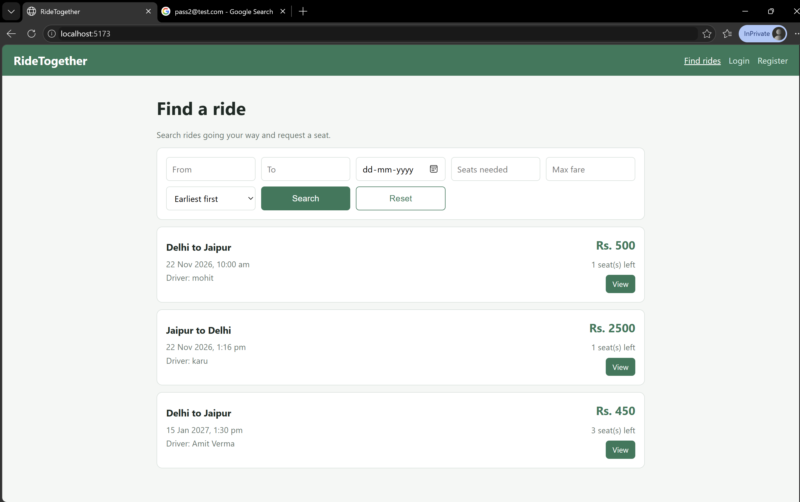 |
| Register | 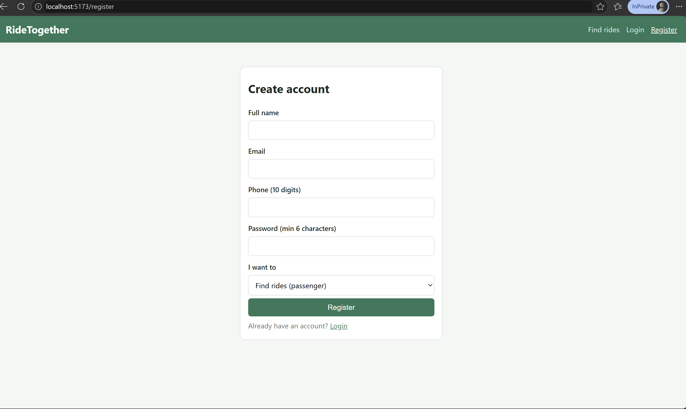 |
| Post a ride (driver) | 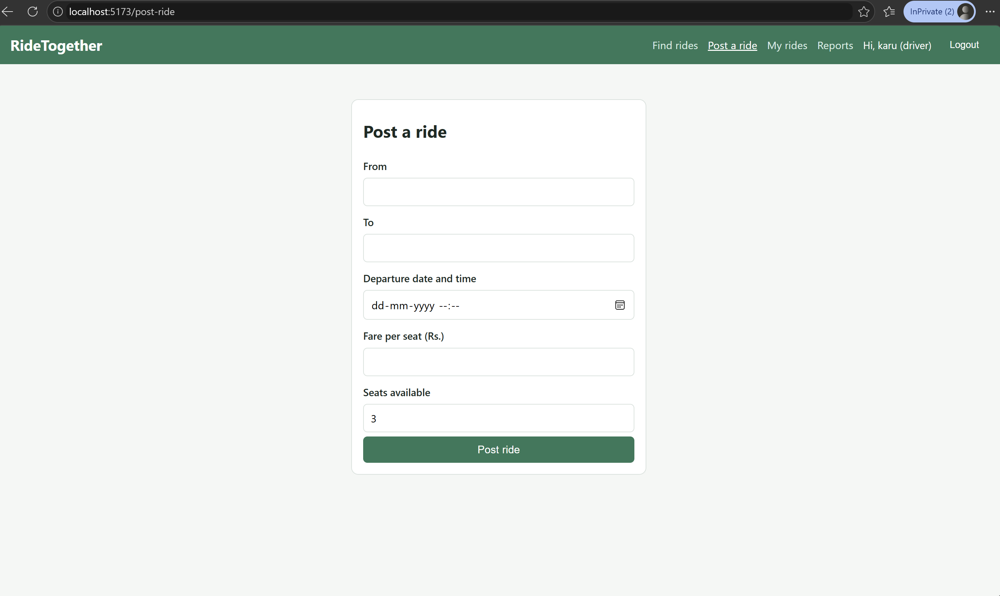 |
| Seat requests (driver) | 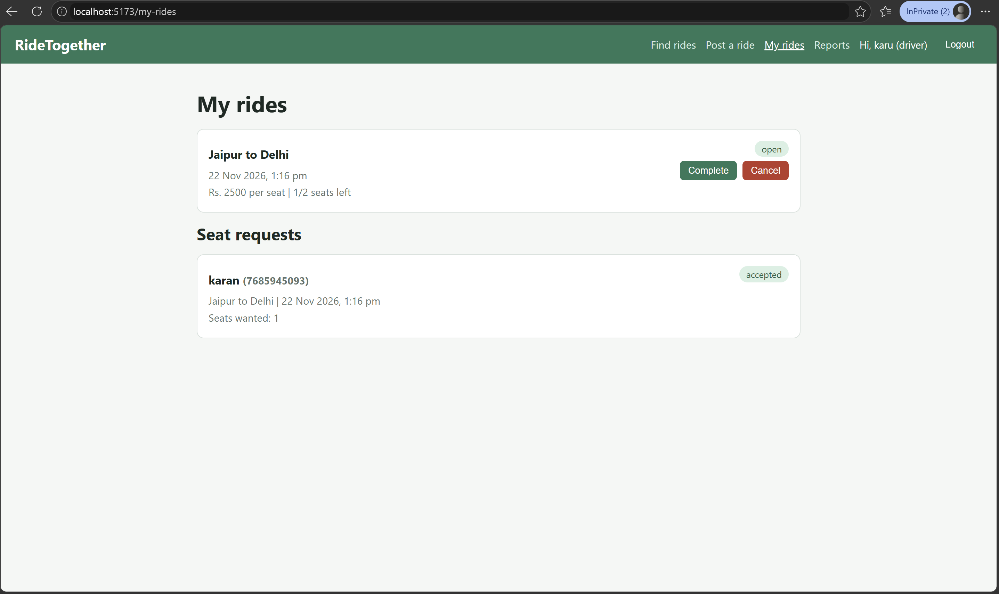 |
| My bookings (passenger) | 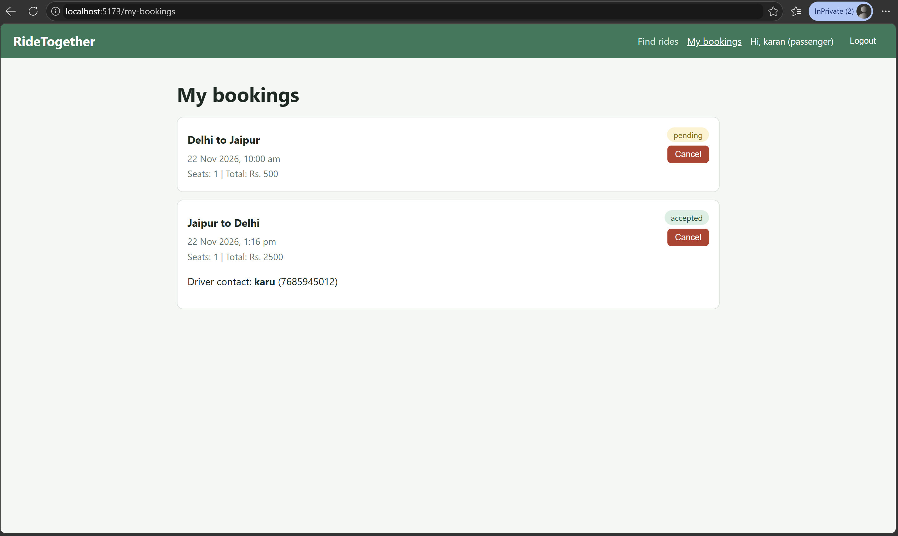 |
| Reports | 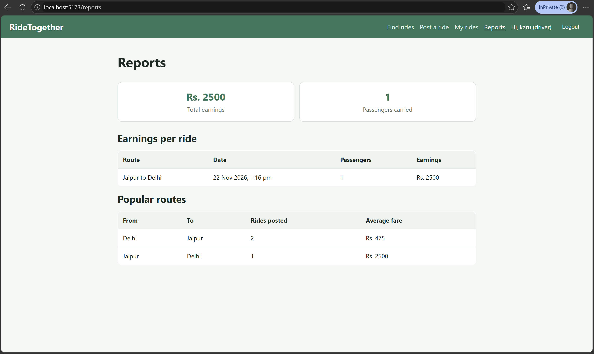 |
| Admin panel | 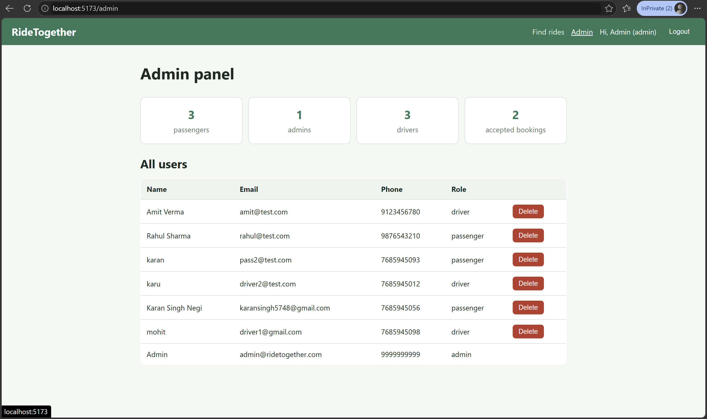 |

### Postman API testing
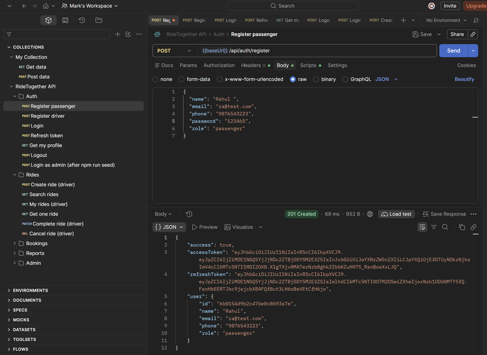
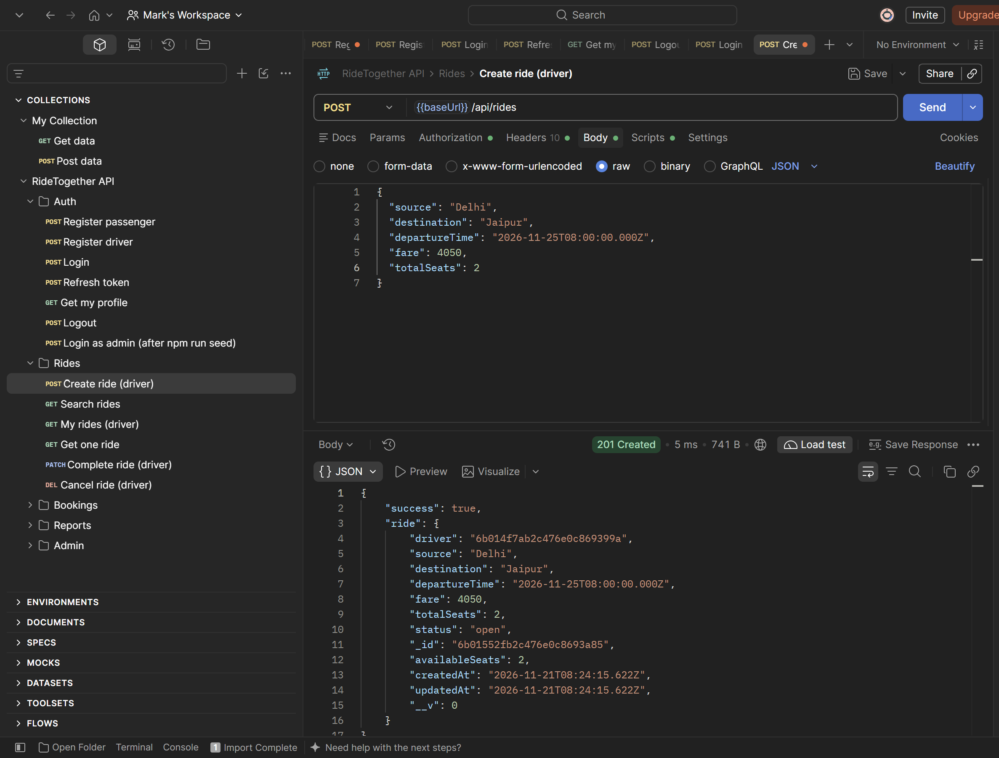
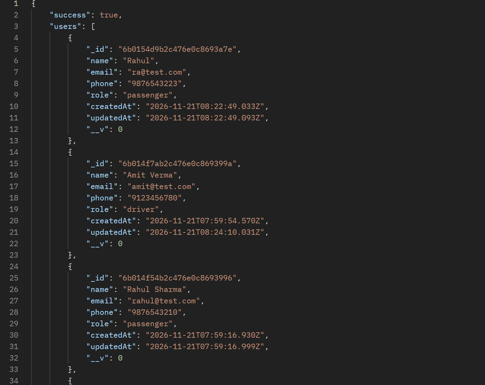
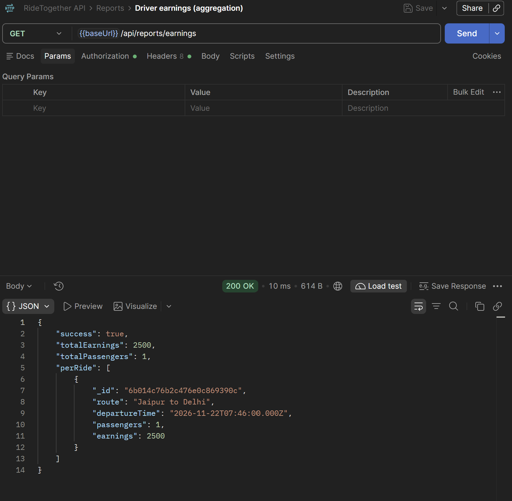

### Database (MongoDB Compass)
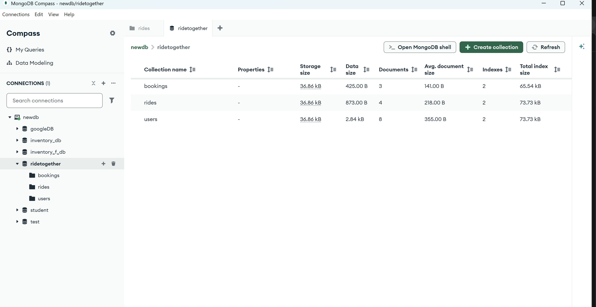

## Tech used
- Backend: express, mongoose, dotenv, bcrypt, jsonwebtoken
- Frontend: react, react-router-dom, Fetch API, Context API (Vite is only the build tool)

## Folder structure
```
RideTogether/
├── server/
│   ├── config/        db.js
│   ├── models/        User.js, Ride.js, Booking.js
│   ├── controllers/   auth, ride, booking, report, admin
│   ├── routes/        authRoutes, rideRoutes, bookingRoutes, reportRoutes, adminRoutes
│   ├── middleware/    authMiddleware (protect + authorize), errorMiddleware, cors
│   ├── utils/         asyncHandler.js
│   ├── seedAdmin.js
│   └── server.js
├── client/src/
│   ├── context/       AuthContext.jsx
│   ├── components/    Navbar, ProtectedRoute, RideCard
│   ├── pages/         Home, Login, Register, RideDetails, PostRide, MyRides, MyBookings, Reports, Admin
│   └── api.js         fetch helper with automatic token refresh
└── postman/           RideTogether.postman_collection.json
```

## Setup steps
You need Node.js and MongoDB (local or Atlas).

**1. Backend**
```
cd server
npm install
cp .env.example .env      # then edit the values
npm run seed              # creates admin: admin@ridetogether.com / admin123
npm run dev               # runs on http://localhost:5000
```

**2. Frontend** (new terminal)
```
cd client
npm install
npm run dev               # runs on http://localhost:5173
```
In development Vite forwards `/api` calls to port 5000, so no extra config is needed.

## Environment variables (server/.env)
| Variable | Meaning |
|---|---|
| PORT | Port for the Express server (5000) |
| MONGO_URI | MongoDB connection string |
| JWT_ACCESS_SECRET | Secret used for access tokens (15 min) |
| JWT_REFRESH_SECRET | Secret used for refresh tokens (7 days) |
| CLIENT_URL | Frontend URL allowed by CORS (used after deployment) |
| NODE_ENV | development / production |

Client (only after deployment): `VITE_API_URL` = full backend URL ending with `/api`.
`.env` is listed in `.gitignore` and must never be committed.

## Database design (ER diagram)
```
┌──────────────┐ 1        many ┌──────────────┐ 1        many ┌──────────────┐
│     User     │───────────────│     Ride     │───────────────│   Booking    │
├──────────────┤  (driver)     ├──────────────┤   (ride)      ├──────────────┤
│ name         │               │ driver  (FK) │               │ ride (FK)    │
│ email (uniq) │               │ source       │               │ passenger(FK)│
│ phone        │               │ destination  │               │ seats        │
│ password     │               │ departureTime│               │ status       │
│ role         │               │ fare         │               └──────────────┘
│ refreshToken │               │ totalSeats   │                      ▲
└──────┬───────┘               │ availableSeats                      │
       │ 1                     │ status       │                      │
       └─────────────────────────────────────────── many ────────────┘
                 (passenger)   └──────────────┘
```
- One User (driver) can post many Rides; one Ride has many Bookings; one User (passenger) can have many Bookings.
- **Indexes:** `Ride` compound index on (source, destination, departureTime) for search;
  `Booking` unique compound index on (ride, passenger) so a passenger has only one booking per ride.
- **Booking status:** pending -> accepted / rejected, and pending/accepted -> cancelled
- **Ride status:** open -> completed / cancelled

## API documentation
Base URL: `http://localhost:5000`. Protected routes need the header `Authorization: Bearer <accessToken>`.

### Auth
| Method | Endpoint | Access | Description |
|---|---|---|---|
| POST | /api/auth/register | Public | Register as driver or passenger |
| POST | /api/auth/login | Public | Login, returns access + refresh token |
| POST | /api/auth/refresh | Public | Send refreshToken, get new tokens |
| POST | /api/auth/logout | Logged in | Invalidate refresh token |
| GET | /api/auth/me | Logged in | Current user |

### Rides
| Method | Endpoint | Access | Description |
|---|---|---|---|
| GET | /api/rides | Public | Search. Query: source, destination, date, seats, maxFare, sort (time, fare_asc, fare_desc), page, limit |
| GET | /api/rides/:id | Public | Ride details |
| GET | /api/rides/mine | Driver | My posted rides |
| POST | /api/rides | Driver | Post a ride |
| PATCH | /api/rides/:id/complete | Driver (owner) | Mark completed |
| DELETE | /api/rides/:id | Driver (owner) | Cancel ride and its bookings |

### Bookings
| Method | Endpoint | Access | Description |
|---|---|---|---|
| POST | /api/bookings | Passenger | Request seats `{ rideId, seats }` |
| GET | /api/bookings/mine | Passenger | My bookings |
| GET | /api/bookings/requests | Driver | Requests on my rides |
| PATCH | /api/bookings/:id/respond | Driver (owner) | `{ action: "accept" | "reject" }` |
| PATCH | /api/bookings/:id/cancel | Passenger (owner) | Cancel booking, seats returned |

### Reports (aggregation)
| Method | Endpoint | Access | Description |
|---|---|---|---|
| GET | /api/reports/earnings | Driver | Total and per-ride earnings |
| GET | /api/reports/popular-routes | Logged in | Top 5 routes by number of rides |

### Admin
| Method | Endpoint | Access | Description |
|---|---|---|---|
| GET | /api/admin/users | Admin | All users |
| DELETE | /api/admin/users/:id | Admin | Delete a user (not admins) |
| GET | /api/admin/stats | Admin | Users per role, bookings per status |

Errors always come back as `{ "success": false, "message": "..." }` with proper status codes
(400 validation, 401 not logged in, 403 wrong role, 404 not found, 409 duplicate).

## Testing with Postman
Import `postman/RideTogether.postman_collection.json`. Run the requests in order
(Register, Login, Create ride, Search, Request seat, Accept...). Tokens and ids are saved into
collection variables automatically. Log in again as the other role when a request needs it.

## Demo flow
1. Register a driver and a passenger (two browsers or one normal + one incognito window)
2. Driver posts a ride
3. Passenger searches it, opens it, requests a seat
4. Driver opens *My rides* and accepts the request
5. Passenger sees the status and the driver's contact in *My bookings*
6. Driver checks *Reports*, admin checks *Admin* page

## Possible future improvements
Socket.IO notifications, ride ratings, map integration, payment gateway.
